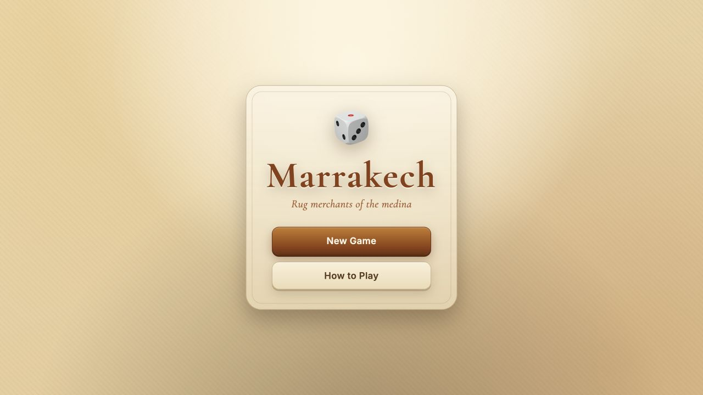

# Marrakech Web

A full-stack TypeScript adaptation of Dominique Ehrhard's board game *Marrakech*. The project combines an immutable rules engine, a custom React interface, algorithmic opponents, an optional LLM opponent, and a small API for move validation and saved games.

**[Play the live demo](https://marrakech-web-api-xnnv.vercel.app/)**

[](https://marrakech-web-api-xnnv.vercel.app/)

## Highlights

- Complete two-to-four-player game flow: rotate, roll, move, settle rent, place rugs, score, and determine a winner.
- Public online lobby with host-approved rooms for two to four people, shared gameplay, and reconnect support. See [multiplayer setup](docs/MULTIPLAYER.md); online hosting requires a persistent single-instance API.
- Random, greedy, and depth-limited expectiminimax opponents that use the same legal-move API as human players.
- Optional LLM opponent with constrained outputs, validation, retry, and deterministic fallback.
- Shared `@marrakech/engine` package used by the browser, API, tests, and evaluation harness.
- Typed Hono API with Zod validation, CORS controls, per-IP rate limiting, and SQLite persistence.
- Save and resume in the browser, responsive layouts, keyboard-friendly dialogs, and reduced-motion support.
- Over 4,000 automated tests across engine rules, fixtures, agents, UI interactions, persistence, and API routes.

## Project timeline

- **February 2025:** Started the project and built the core rules, playable React interface, scenes, animation, save and resume, and accessibility support.
- **March 2026:** Added algorithmic and LLM opponents, the seeded evaluation harness, shared engine workspace, API, persistence, and model-provider adapters. This marked the end of the project’s active development period.
- **October 2026:** Refreshed dependencies and portfolio documentation, then added public multiplayer rooms, board-relative direction controls, and printed corner-route animations.

## Architecture

```text
Browser (React + Vite)
  ├─ scenes, animation, accessibility, local persistence
  ├─ random / greedy / search agents
  └─ LLM requests ───────────────┐
                                 │ HTTPS
API (Hono + Node)                │
  ├─ validates request bodies ◀──┘
  ├─ derives legal moves with the shared engine
  ├─ calls an OpenAI-compatible or Anthropic model
  └─ persists game snapshots in SQLite

Shared package: @marrakech/engine
  └─ immutable rules, move enumeration, scoring, agents
```

The engine has no React or DOM dependency. Every transition accepts a `GameState` and returns a new state, and randomness is injected so games can be replayed under test.

## AI opponents

| Agent | Approach |
|---|---|
| Random | Uniform selection from legal moves. |
| Greedy | Immediate board evaluation; rotation uses expected value over the die distribution. |
| Search | Depth-two expectiminimax with explicit decision and chance nodes. |
| LLM | Selects from enumerated legal actions; invalid output is retried and then falls back to greedy. |

The evaluation harness runs seeded matches, alternates the first player, and reports win rate, illegal moves, latency, and game length. In a recorded 30-game comparison, the corrected search agent won 19 games against greedy with zero illegal moves. The harness exposed an earlier opponent-node evaluation bug and provided a reproducible check for the fix.

```bash
npm run eval                       # greedy vs random, 50 games
npm run eval -- search greedy 30   # search vs greedy
npm run eval -- llm greedy 10      # requires ANTHROPIC_API_KEY
```

See [AI design notes](docs/AI.md) for the move contract, search tree, and LLM validation loop.

## API

| Method | Endpoint | Purpose |
|---|---|---|
| `GET` | `/api/health` | Health check |
| `POST` | `/api/ai-move` | Return a validated rotation or rug placement |
| `POST` | `/api/games` | Save a game snapshot |
| `GET` | `/api/games/:id` | Load a saved game |
| `PUT` | `/api/games/:id` | Update a saved game |

The model key remains on the server. The API derives legal moves from the submitted state instead of trusting client-provided move lists.

## Technology

- TypeScript 6, React 19, Vite 8
- Hono, Zod, SQLite
- OpenAI-compatible and Anthropic SDK adapters
- Vitest, React Testing Library, ESLint
- Hand-written CSS and design tokens
- npm workspaces

## Repository layout

```text
packages/engine/    pure rules, move generation, scoring, and agents
apps/api/           HTTP API, provider adapters, persistence, rate limiting
src/                React application and browser integrations
eval/               seeded head-to-head agent evaluation
tests/              rules, fixtures, agents, UI, persistence, and API tests
docs/               technical notes for AI, testing, and data modelling
```

## Run locally

Requirements: Node.js 22.13+ and npm (the API uses built-in SQLite).

```bash
npm install
npm run dev
```

For online multiplayer and the optional LLM seat:

```bash
cp .env.example .env
npm run dev:api       # http://localhost:8787
npm run dev           # http://localhost:5173, in another terminal
```

Human online games do not require a model API key. Open the web app in two separate browsers, choose **Play online**, and create/request entry to the same room. Configure `WEB_ORIGIN` and `VITE_API_URL` for deployment; see [online rooms and hosting](docs/MULTIPLAYER.md).

Set `LLM_PROVIDER=anthropic` to use Anthropic. The default adapter supports OpenAI-compatible endpoints through `OPENAI_API_KEY`, `OPENAI_BASE_URL`, and `OPENAI_MODEL`.

## Quality checks

```bash
npm test
npm run lint
npm run build
npm run typecheck:api
```

Further details:

- [Testing strategy](docs/TESTING.md)
- [Entity model](docs/ERD.md)

## Credits and scope

*Marrakech* was designed by Dominique Ehrhard and published by Gigamic. This unofficial adaptation was built for learning and portfolio use and is not affiliated with the designer or publisher.

The *Marrakech* name, game design, and photographed game components remain the property of their respective rights holders.
