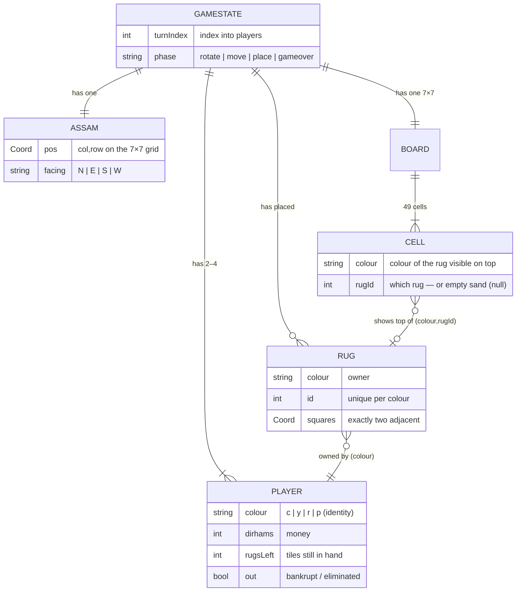
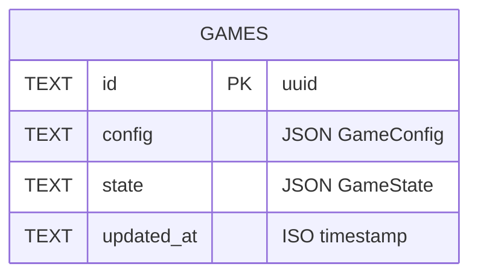

# Data model & ERD

Marrakech has two distinct data pictures, and it's worth being clear about which
is which:

1. **The domain model** — the in-memory `GameState` tree that the pure engine
   treats as the single source of truth during play. It never touches a database.
2. **The persistence schema** — how a saved game is stored by the API so it can
   be resumed. This is deliberately thin: the whole game is one JSON aggregate.

---

## 1. Domain model (`GameState`)

Defined in [`packages/engine/src/game/types.ts`](../packages/engine/src/game/types.ts).
`GameState` is an **immutable aggregate**: every rule takes one and returns a new
one, and the whole thing is plain JSON-serialisable data (no classes, no methods,
no cycles).



### Entities and relationships

| Entity | What it is | Key relationships |
|---|---|---|
| **GameState** | The root aggregate — one live game. | Owns the players, Assam, board, and rug list. |
| **Player** | A merchant. Identified by `colour` (`c/y/r/p`). | 2–4 per game; owns rugs by matching colour. |
| **Assam** | The shared merchant pawn everyone moves. | Exactly one; his `pos`/`facing` drive rent + placement legality. |
| **Rug** | A tile covering **two adjacent squares**, owned by a colour, with a per-colour `id`. | Belongs to one player (by colour); projects onto 1–2 board cells (see below). |
| **Board** | A fixed **7×7** grid, `board[col][row]`. | 49 cells; not a separate object, just `Cell[][]`. |
| **Cell** | One square: `{ colour, rugId }` for the rug **visible on top**, or `null` for empty sand. | References the rug currently showing there. |

### Two modelling decisions worth calling out

- **Score is derived, never stored.** A player's score is
  `dirhams + visible squares of their colour`, computed on demand by `scoreOf`.
  Storing it would invite denormalisation bugs; recomputing is cheap and always
  correct.
- **A rug's two squares aren't always both visible.** Rugs may overlap, so a
  later rug can cover one square of an earlier one. The `board` only records the
  *top* rug at each cell, while `state.rugs` keeps every rug's full two-square
  footprint. That gap is exactly why the old lossy game-string format couldn't
  round-trip a covered rug — and why live persistence stores the whole aggregate
  (below) rather than reconstructing it from the board.

<!-- APPEND-MARKER -->
---

## 2. Persistence schema

Saved games live behind a small `GameStore` interface
([`apps/api/src/store.ts`](../apps/api/src/store.ts)) so the storage engine is
swappable. Two implementations ship: `SqliteStore` (`node:sqlite`, the default)
and `MemoryStore` (an in-process `Map`, used by the route tests). Production
would add a Postgres implementation behind the same interface without touching
any route code.

### The `games` table

```sql
CREATE TABLE IF NOT EXISTS games (
  id         TEXT PRIMARY KEY,   -- randomUUID()
  config     TEXT NOT NULL,      -- JSON: player count, names, seat kinds
  state      TEXT NOT NULL,      -- JSON: the full GameState aggregate
  updated_at TEXT NOT NULL       -- ISO timestamp
);
```



`config` mirrors the web app's `GameConfig` (count, display names, and which
seats are human vs AI); `state` is the serialised `GameState` from §1.

### Why one table with JSON columns, not normalised tables

A normalised schema would explode `GameState` into `players`, `rugs`, and 49
`cells` rows per game. That's the wrong shape here, deliberately:

- **The game is a single aggregate.** It's always read and written as one whole —
  you never query "all red rugs across every game." Splitting it into rows would
  add joins and write-transaction complexity for zero query benefit.
- **The engine already owns every invariant.** Rug adjacency, rent, legal
  placement, turn order — all enforced in pure functions. A relational schema
  would either duplicate those rules as constraints or leave them unenforced;
  storing the validated aggregate keeps one source of truth.
- **It maps cleanly forward.** `TEXT` JSON in SQLite becomes `jsonb` in Postgres
  with no shape change. If real relational queries ever matter (leaderboards,
  per-player win rates), the natural move is to add *indexed columns alongside*
  the JSON — e.g. a `winner` or `finished_at` column populated on save — rather
  than shred the aggregate.

### Lifecycle

| API route | Store call | Effect |
|---|---|---|
| `POST /api/games` | `create(config, state)` | Insert a new row, return its `id`. |
| `GET /api/games/:id` | `get(id)` | Load a saved game (404 if unknown). |
| `PUT /api/games/:id` | `update(id, state)` | Overwrite `state` + bump `updated_at`. |

The browser also keeps a `localStorage` snapshot for instant offline resume;
server persistence is what enables cross-device resume and shareable game links.

